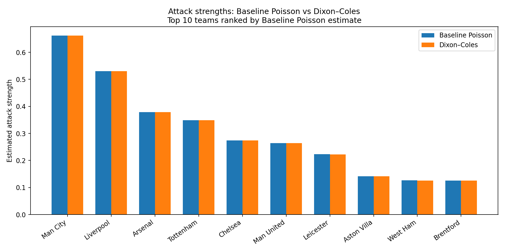
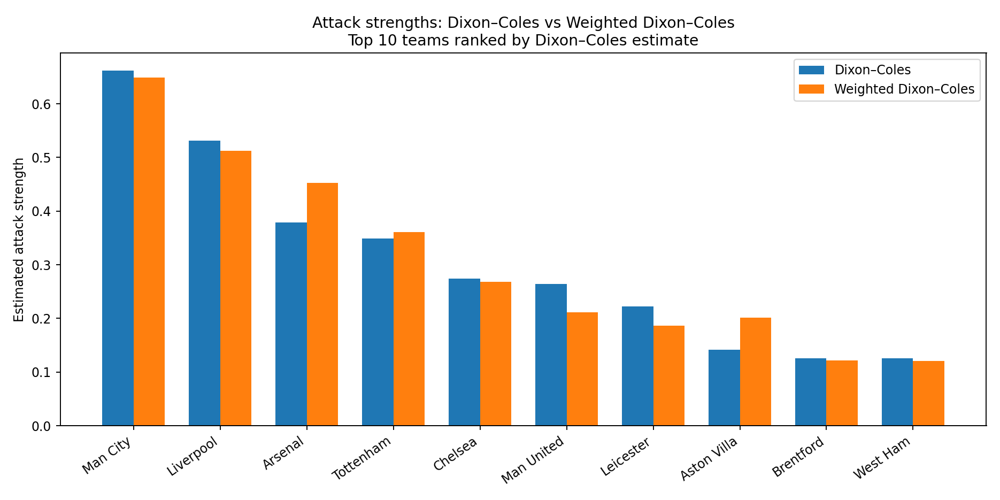
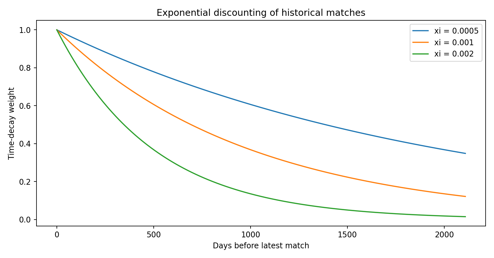

# English Premier League Match Modelling

**Poisson, Dixon–Coles and Time-Decay Models | Python Statistical Modelling Portfolio**

This repository presents a reproducible, organised version of my undergraduate mathematics and statistics dissertation, *Modeling English Premier League Match Outcomes Using Poisson and Dixon–Coles Models* (University of Southampton, 2026).

The project models English Premier League match scorelines using six completed seasons (2018/19–2023/24), covering **2,280 matches and 28 teams**. Its main goal is to estimate team attack and defence strengths and compare how assumptions about low-score dependence and match recency affect the estimates.

## Research questions

1. Can an independent Poisson attack–defence model capture EPL score patterns?
2. Does the Dixon–Coles low-score adjustment materially improve fit?
3. How do team strength estimates change when recent matches receive greater weight?

## Approaches

| Model | Description |
|---|---|
| **Baseline Poisson** | Independent home and away goal counts with team-specific attack and defence, plus a shared home advantage. |
| **Dixon–Coles** | Adds a dependence correction for scorelines 0–0, 0–1, 1–0 and 1–1. |
| **Weighted Dixon–Coles** | Uses exponential time-decay weights `exp(-xi * days_from_latest)` (default `xi = 0.001`). |

Expected home and away goals for teams *i* and *j* are

- `home_lambda = exp(attack[i] - defence[j] + home_advantage)`
- `away_mu = exp(attack[j] - defence[i])`

Model parameters are estimated with **constrained maximum likelihood**, using SciPy's SLSQP optimiser and an identifiability constraint `sum(attack) = 0`. The Dixon–Coles dependence parameter is bounded to `[-0.2, 0.2]`, matching the original modelling implementation.

## Reproduced findings

The reorganised Python implementation was run against the original dissertation dataset and matched its published results to the displayed precision:

| Metric | Baseline Poisson | Dixon–Coles | Weighted Dixon–Coles |
|---|---:|---:|---:|
| Reduced negative log-likelihood | 3772.1979 | 3772.1298 | 1564.5435 |
| Home advantage | 0.1846 | 0.1847 | 0.1934 |
| Low-score dependence (`rho`) | – | -0.0104 | -0.0001 |

- **Baseline vs Dixon–Coles:** Likelihood-ratio statistic about 0.136 and p-value about 0.712, so the extra low-score dependence parameter was not statistically justified on this dataset. The simpler baseline model is favoured by the AIC *difference*.
- **Weighted Dixon–Coles:** Recency weighting produces a more recent-form-oriented estimate of relative team strengths while broadly preserving the rankings. The weighted negative log-likelihood **cannot be directly compared** to the unweighted values.
- **Interpretation:** Higher defence parameters indicate stronger defence, because they reduce opposing goal intensity in the model specification.

**Notes on likelihoods:** For numerical estimation, log-factorial terms are omitted from all three objectives because they are constant with respect to the fitted parameters. Consequently, reduced NLL values above are not absolute full negative log-likelihoods. `results/model_comparison.csv` reports an AIC-like quantity omitting the same constant from both unweighted models; the **AIC difference** is still meaningful. These are in-sample model-fit results, **not** a demonstrated out-of-sample predictive improvement.

## Visualisations







## Repository organisation

```text
.
├── README.md
├── requirements.txt
├── src/
│   └── models.py                 # Poisson and Dixon–Coles likelihoods and fitting
├── scripts/
│   ├── prepare_data.py           # Merge, validate and index historical EPL results
│   ├── run_analysis.py           # Fit and compare the three models
│   └── create_figures.py         # Regenerate visualisations from fitted parameters
├── tests/
│   └── test_models.py            # Mathematical consistency checks
├── data/
│   ├── README.md                 # Original data source and setup guidance
│   ├── raw/                      # Local CSV inputs (gitignored)
│   └── processed/                # Local clean modelling dataset (gitignored)
├── results/                     # Exported parameter tables and model comparison
└── figures/                     # Reproducible analysis plots
```

## Running the code

Use Python 3.10+ from the repository root.

1. Create a virtual environment (optional but recommended) and install dependencies:

   ```bash
   python -m pip install -r requirements.txt
   ```

2. Download or supply the six historical EPL season files under `data/raw/`, following [data/README.md](data/README.md). The CSV data is **not included** in this repository draft pending verification of redistribution permissions.

3. Prepare the dataset:

   ```bash
   python scripts/prepare_data.py
   ```

4. Fit all models and save results:

   ```bash
   python scripts/run_analysis.py --xi 0.001
   ```

5. Regenerate the figures:

   ```bash
   python scripts/create_figures.py
   ```

6. Run tests:

   ```bash
   python -m unittest discover -s tests -v
   ```

This is an **analysis and interpretation project**, not a production forecasting system. In particular, it does not claim out-of-sample forecast accuracy or causal evidence about match outcomes.

## Credits and data

- Dissertation by **Gewei Cheng** (2026), School of Mathematical Sciences, University of Southampton.
- Original historical match data from [football-data.co.uk](https://www.football-data.co.uk/), as cited in the dissertation. Please respect the provider's current terms and permissions.
- Statistical foundations: Maher's attack–defence Poisson modelling and the Dixon–Coles low-score correction and recency-weighting approach, discussed in the dissertation.

**Academic integrity:** This repository reorganises the author's existing dissertation analysis for portfolio presentation. It does not include the original assessed PDF or student ID.
